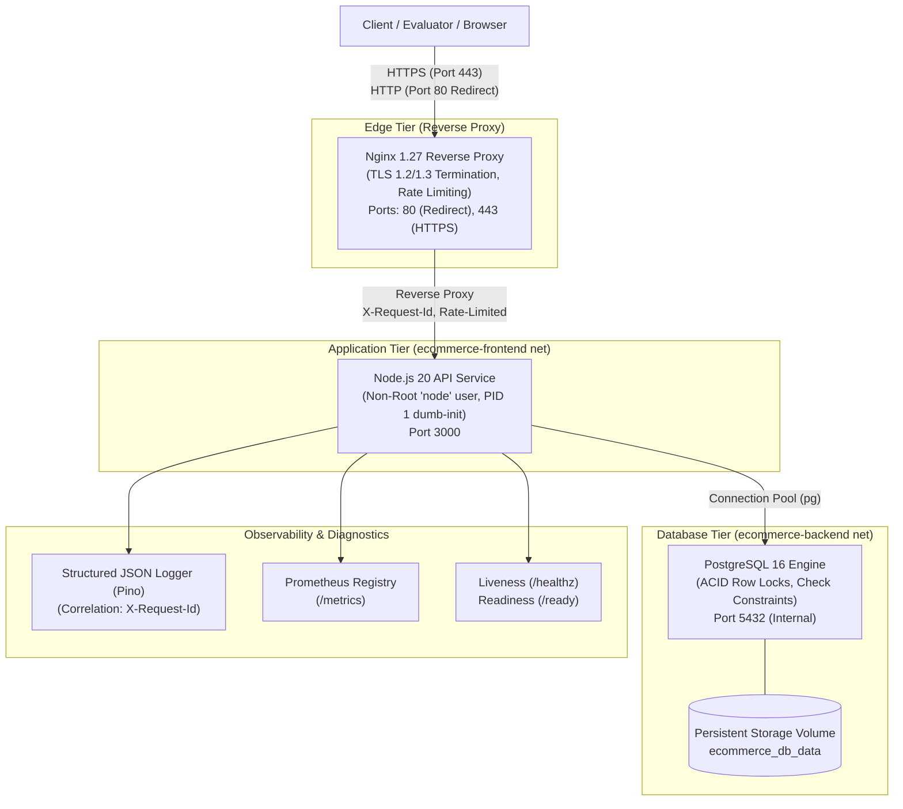

# Cloud Deployment & CI/CD – E-Commerce Platform
[](https://github.com/imanapriya/ecommerce-platform/actions/workflows/ci-cd.yml)
[](https://nodejs.org/)
[](https://opensource.org/licenses/MIT)
[](https://www.docker.com/)
[](https://www.postgresql.org/)

Production-style Cloud Deployment and CI/CD engineering implementation for a domain-specific E-Commerce Product and Order API, built for **ALGIONS AI LABS PRIVATE LIMITED** (DevOps & Cloud Engineering Internship Assessment).

---

## Table of Contents
1. [Mission & Domain Scope](#mission--domain-scope)
2. [System Architecture](#system-architecture)
3. [Network Topology & Port Map](#network-topology--port-map)
4. [Environment Variables](#environment-variables)
5. [Quickstart & Deployment Guide](#quickstart--deployment-guide)
6. [API Specification & Endpoints](#api-specification--endpoints)
7. [Acceptance Test Verification](#acceptance-test-verification)
8. [Observability & Monitoring](#observability--monitoring)
9. [Disaster Recovery & Rollback](#disaster-recovery--rollback)
10. [Submission Package & Documentation](#submission-package--documentation)

---

## 1. Mission & Domain Scope

Deploy a resilient, observable, and recoverable e-commerce product and order API service conforming to strict production engineering practices:
- **Product Catalog:** Querying, filtering, and detail lookups with seed data.
- **Atomic Order Checkout:** Strict validation of product availability, quantity, and price snapshotting.
- **Negative Stock Prevention:** Row-level pessimistic locking (`FOR UPDATE`) and database constraints (`CHECK (stock >= 0)`).
- **Idempotency Guarantee:** Deduplication via client-provided `Idempotency-Key` headers; repeated requests never double-deduct stock or duplicate orders.
- **Administrative Protection & Audit:** Secure administrative stock modifications with mandatory audit trail logging (`audit_logs`).
- **Observability:** Health (`/healthz`), readiness (`/ready`), Prometheus metrics (`/metrics`), and correlation ID request tracing (`X-Request-Id`).

---

## 2. System Architecture



For detailed architectural flowcharts, sequence diagrams, and threat models, see [docs/architecture.md](docs/architecture.md).

---

## 3. Network Topology & Port Map

| Component | Container Name | Internal Port | Host Port | Protocol | Scope / Binding |
| :--- | :--- | :--- | :--- | :--- | :--- |
| **Nginx Reverse Proxy** | `ecommerce-proxy` | 80, 443 | `80:80`, `443:443` | HTTP / HTTPS | Public Ingress |
| **E-Commerce API** | `ecommerce-api` | 3000 | `127.0.0.1:3000` | HTTP | Internal Bridge / Localhost |
| **PostgreSQL Database** | `ecommerce-db` | 5432 | `127.0.0.1:5432` | TCP | Internal Bridge / Localhost |

---

## 4. Environment Variables

All settings use environment-based configuration. Never commit secrets; use `.env.example` as a template:

| Variable | Default Value | Description |
| :--- | :--- | :--- |
| `NODE_ENV` | `production` | Node execution environment |
| `PORT` | `3000` | Internal API listen port |
| `APP_VERSION` | `1.0.0` | Semantic version of the build |
| `LOG_LEVEL` | `info` | Logging verbosity (`debug`, `info`, `warn`, `error`) |
| `ADMIN_API_KEY` | `algions-admin-secret-key-2026` | Secret token for administrative updates |
| `DB_HOST` | `db` | Database hostname (Docker service name) |
| `DB_PORT` | `5432` | Database TCP port |
| `DB_USER` | `postgres` | PostgreSQL username |
| `DB_PASSWORD` | `postgres_secure_pass_2026` | PostgreSQL password |
| `DB_NAME` | `ecommerce_db` | Relational database name |
| `AUTO_MIGRATE` | `true` | Automatically run migrations on startup |
| `ENABLE_METRICS`| `true` | Expose Prometheus metrics on `/metrics` |

---

## 5. Quickstart & Deployment Guide

### Prerequisites
- [Docker](https://docs.docker.com/get-docker/) & [Docker Compose](https://docs.docker.com/compose/)
- [Node.js 20+](https://nodejs.org/) (for standalone local development and testing)

### 5.1 Docker Compose Deployment (Recommended)
```bash
# 1. Clone repository
git clone https://github.com/imanapriya/ecommerce-platform.git
cd ecommerce-platform

# 2. Copy environment file
cp .env.example .env

# 3. Ensure TLS certificates are present (already generated in docker/nginx/ssl/)
# To regenerate: ./scripts/generate-ssl.sh (or pwsh ./scripts/generate-ssl.ps1)

# 4. Build and start services
docker compose up -d --build

# 5. Check container health status
docker compose ps
```

### 5.2 Local Standalone Run (Development / Testing)
```bash
# 1. Install dependencies
npm ci

# 2. Run static lint check
npm run lint

# 3. Run automated tests (100% in-memory / zero external DB required!)
npm test

# 4. Start API server
npm start
```

---

## 6. API Specification & Endpoints

### 6.1 Health & Probes
- `GET /healthz` - Liveness probe (returns 200 OK + uptime)
- `GET /ready` - Readiness probe (checks PostgreSQL connectivity, pool status; 200 OK or 503)
- `GET /metrics` - Prometheus metrics scraping endpoint

### 6.2 Product Catalog
- `GET /api/products` - List products with pagination & search (`?category=...&search=...&limit=10`)
- `GET /api/products/:id` - Get product details by ID

### 6.3 Order Checkout (Idempotent)
- `POST /api/orders`
  - Required Header: `Idempotency-Key: <UUID>`
  - Body:
    ```json
    {
      "customerName": "Jane Doe",
      "customerEmail": "jane@example.com",
      "items": [
        { "productId": 1, "quantity": 1 },
        { "productId": 3, "quantity": 2 }
      ]
    }
    ```
  - First execution returns `201 Created` with `X-Idempotent-Replay: false`.
  - Re-sending with identical key returns `200 OK` with `X-Idempotent-Replay: true` without modifying inventory.

### 6.4 Administrative Operations (Protected)
- `PUT /api/admin/products/:id/stock`
  - Required Header: `X-Admin-Token: algions-admin-secret-key-2026`
  - Body: `{"stock": 100, "reason": "Restock shipment arrival"}`
  - Modifies stock and records an event in `audit_logs`.
- `GET /api/admin/audit-logs`
  - Required Header: `X-Admin-Token: algions-admin-secret-key-2026`
  - Returns audit log history with actor, timestamp, previous stock, and new stock.

---

## 7. Acceptance Test Verification

All 5 assessment acceptance tests have been fully implemented and verified:

### Acceptance Test 1: Repeated Checkout Idempotency
> *Repeated checkout with the same idempotency key must not create duplicate orders or double-deduct inventory.*
- **Automated Test:** `tests/integration/idempotency.test.js`
- **Verification:** Run `npm test` -> `tests/integration/idempotency.test.js` executes 3 successive checkout requests with the same idempotency key. Asserts initial deduction succeeds, subsequent requests return the existing order (`X-Idempotent-Replay: true`), inventory remains unchanged, and exactly 1 order row exists in the database.

### Acceptance Test 2: Clean Environment Reproducibility
> *A clean environment can build and start the service using documented steps.*
- Multi-stage `Dockerfile` with minimal layers, non-root user `node`, and `docker-compose.yml` with health-dependent startup ordering (`condition: service_healthy`).

### Acceptance Test 3: CI/CD Pipeline
> *A CI run executes checks/tests and produces a versioned build artifact/image.*
- **Workflow:** `.github/workflows/ci-cd.yml`
- Executes ESLint, `npm audit`, integration tests against PostgreSQL 16 container, Docker multi-stage build, Trivy security CVE scan, and semantic version tagging (`v1.0.<RUN_NUMBER>`).

### Acceptance Test 4: Failure Detection & Self-Healing Chaos Drill
> *Show health/readiness and logs; deliberately stop or break one service and demonstrate detection/recovery.*
- **Script:** `./scripts/chaos-drill.sh` (or `.\scripts\chaos-drill.ps1`)
- Stops the database container -> `/ready` immediately reports 503 Unhealthy and logs connection error -> Restarts database -> `/ready` automatically recovers to 200 OK without manual API restart.

### Acceptance Test 5: Backup, Restore & Rollback
> *Restore a backup or show a rollback procedure with evidence.*
- **Backup Script:** `./scripts/backup.sh` (produces compressed dump with SHA256 checksum)
- **Restore Script:** `./scripts/restore.sh` (restores snapshot and verifies entity counts)
- **Rollback Script:** `./scripts/rollback.sh 1.0.0` (zero-downtime rolling downgrade to stable tag)

---

## 8. Observability & Monitoring

### Structured JSON Logs
All request logs are emitted in JSON format containing:
- `time`: ISO 8601 timestamp
- `level`: Log level (`info`, `warn`, `error`)
- `correlationId`: `X-Request-Id` for end-to-end tracing
- `req`: Method, URL, headers
- `res`: Status code, response time

```bash
# View live application logs
docker compose logs -f api
```

### Prometheus Metrics
Exposed at `/metrics`:
- `ecommerce_http_request_duration_seconds` (Histogram by route & status code)
- `ecommerce_http_requests_total` (Counter)
- `ecommerce_orders_created_total` (Counter with labels `outcome: new | idempotent_duplicate | failed`)
- `ecommerce_inventory_adjustments_total` (Counter by action)

---

## 9. Disaster Recovery & Rollback

### Automated Database Backup
```bash
./scripts/backup.sh          # Linux / macOS
.\scripts\backup.ps1         # Windows PowerShell
```

### Database Restore
```bash
./scripts/restore.sh         # Linux / macOS
.\scripts\restore.ps1        # Windows PowerShell
```

### Zero-Downtime Rollback
```bash
./scripts/rollback.sh 1.0.0  # Linux / macOS
.\scripts\rollback.ps1 -TargetTag "1.0.0"
```

For operational playbooks, troubleshooting trees, and incident handling guides, see [docs/runbook.md](docs/runbook.md).

---

## 10. Submission Package & Documentation

- [docs/architecture.md](docs/architecture.md) - System architecture, sequence diagrams, and security models
- [docs/runbook.md](docs/runbook.md) - Operations runbook, zero-downtime procedures, and incident response
- [docs/submission-guide.md](docs/submission-guide.md) - Pre-filled internship submission form fields and 3-5 minute video script

---

## License
MIT License. Developed for Algions AI Labs Private Limited Assessment.
