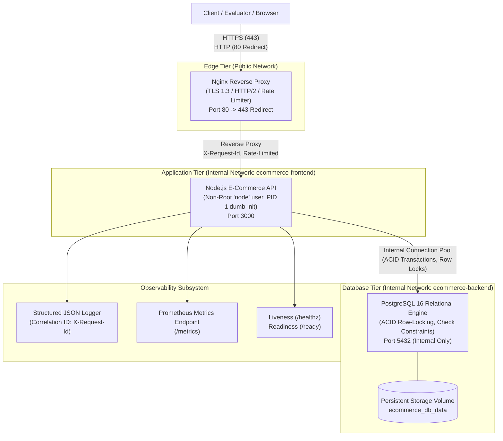
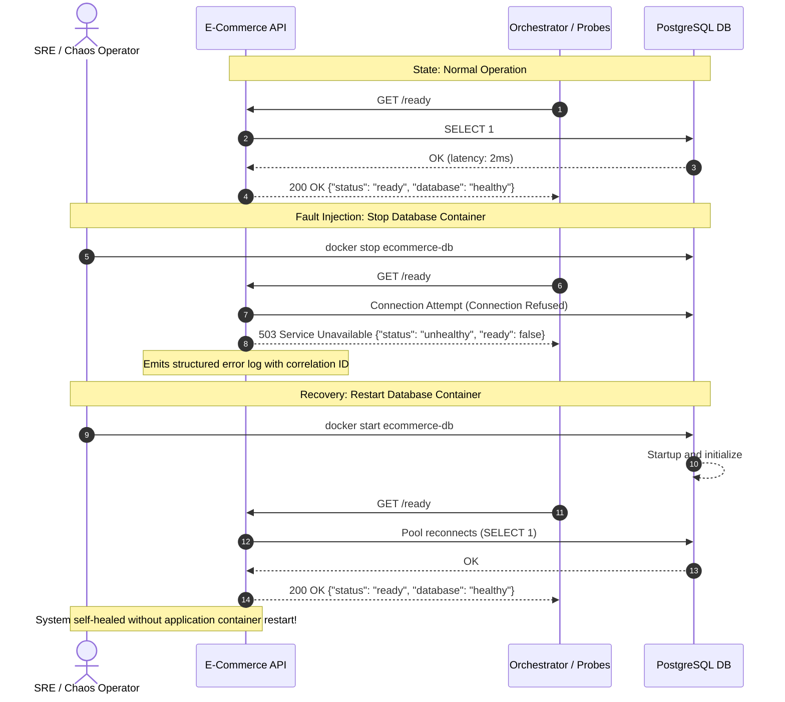
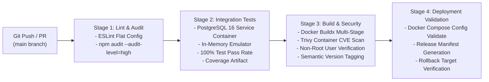

# Architecture & System Design Specification
**Project:** Cloud Deployment & CI/CD – E-Commerce Platform  
**Target Domain:** E-Commerce Product & Order Service  
**Organization:** ALGIONS AI LABS PRIVATE LIMITED

---

## 1. System Topology & Network Architecture

The deployment topology enforces least privilege, defense-in-depth, network tier isolation, and secure TLS termination.



---

## 2. Idempotent Checkout & Atomic Inventory Workflow

Acceptance Test #1 mandates that repeated checkout requests with the same idempotency key must not create duplicate orders or double-deduct inventory.

```mermaid
sequenceDiagram
    autonumber
    actor Customer as Customer / Client
    participant Proxy as Nginx Proxy
    participant API as E-Commerce API
    participant DB as PostgreSQL 16

    Customer->>Proxy: POST /api/orders (Header: Idempotency-Key: UUID)
    Proxy->>API: Forward request with X-Request-Id
    
    API->>DB: SELECT * FROM orders WHERE idempotency_key = $key
    alt Key already exists (Idempotent Replay)
        DB-->>API: Returns existing order record
        API-->>Customer: 200 OK (X-Idempotent-Replay: true, original order payload)
    else First checkout attempt (New Order)
        API->>DB: BEGIN TRANSACTION
        loop For each order item
            API->>DB: SELECT * FROM products WHERE id = $id FOR UPDATE
            Note over DB: Locks product row exclusively
            alt Insufficient Stock / Inactive
                API->>DB: ROLLBACK
                API-->>Customer: 400 Bad Request (Insufficient Stock)
            else Stock Available
                API->>DB: UPDATE products SET stock = stock - qty
                Note over DB: Atomic deduction; DB CHECK constraint prevents stock < 0
            end
        end
        API->>DB: INSERT INTO orders (...)
        API->>DB: INSERT INTO order_items (...) with price snapshot
        API->>DB: INSERT INTO audit_logs (...)
        API->>DB: COMMIT TRANSACTION
        API-->>Customer: 201 Created (X-Idempotent-Replay: false, new order details)
    end
```

---

## 3. Resiliency & Chaos Drill Workflow (Acceptance Test #4)

Demonstrates automatic failure detection and self-healing when a critical backend service fails and recovers.



---

## 4. CI/CD Pipeline Architecture



---

## 5. Security & Isolation Controls

| Security Control | Implementation |
| :--- | :--- |
| **Non-Root Execution** | Application runs as unprivileged user `node` (`UID 1000`) inside container |
| **Process Supervision** | `dumb-init` runs as PID 1 to handle SIGTERM/SIGINT signals cleanly |
| **Network Segmentation** | Database container is isolated on `ecommerce-backend` network and not exposed to the public internet |
| **TLS/SSL Encryption** | Nginx terminates TLS 1.2 and 1.3 with modern AEAD cipher suites |
| **Secret Management** | Credentials passed via environment variables; `.gitignore` prevents secret check-in |
| **Database Constraints** | `CHECK (stock >= 0)` enforces at database engine level that stock can never become negative |
| **Rate Limiting** | Nginx enforces 15 req/sec with burst buffer to mitigate DoS / brute-force abuse |
| **Administrative RBAC** | Admin stock updates require `X-Admin-Token` and record full audit entries with actor details |
